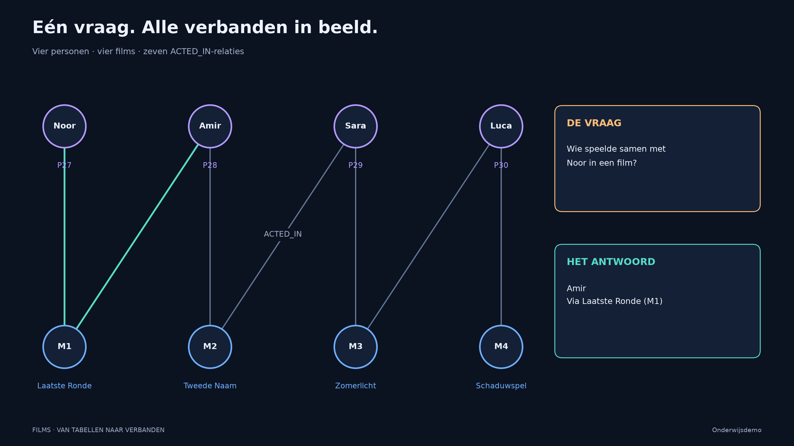

# Films, verbanden en lokale GraphRAG

**Volg één kleine filmwereld van SQL en Cypher tot een antwoord met controleerbare bronnen.** Vier personen, vier films en zeven castrelaties laten zien hoe tekst zoeken en verbanden onderbouwen elkaar aanvullen.

## Begin bij het notebook

Open [demo.ipynb](demo.ipynb) voor de onderwijsroute: modellen vergelijken, dezelfde vraag in twee talen stellen, werkelijke uitvoeringsplannen lezen en vijf retrievalroutes onderzoeken. Het notebook is op 28 oktober 2026 volledig uitgevoerd en bevat de echte tabellen, figuren, zoekqueries, exacte context en modelantwoorden als opgeslagen outputs. Je kunt het rechtstreeks op GitHub lezen, zonder installatie.

Wil je alleen kijken? Download [demo.html](demo.html) en open het bestand in een browser. De statische weergave vereist geen databases, Python of modellen. Voor opnieuw uitvoeren volg je de [handleiding](HANDLEIDING.md).

## Drie vragen die steeds meer bewijs vragen

1. **Met wie speelde Noor samen in een film?** SQL en Cypher leveren dezelfde collega op: Amir, via *Laatste Ronde* (M1).
2. **Welke films gaan over iemand die onder een andere identiteit leeft?** De samenvattingen van *Tweede Naam* (M2) en *Schaduwspel* (M4) bieden inhoudelijke aanknopingspunten.
3. **Welke van die films heeft een acteur die met Noor samenspeelde?** Daarvoor is castinformatie nodig: M2 heeft het korte patroon `Noor → M1 ← Amir → M2`. M4 voldoet niet aan die relatievoorwaarde. De langere verbinding via andere personen en films is iets anders.

Deze filmwereld is fictief. De bronfiches [S1](sources/S1.md), [S2](sources/S2.md), [S3](sources/S3.md) en [S4](sources/S4.md) maken de herkomst binnen deze onderwijsdemo controleerbaar.

## Vijf manieren om context op te halen

| Retriever | Zoekroute | Leerdoel |
| --- | --- | --- |
| `VectorRetriever` | Overeenkomst tussen embeddings van samenvattingen | Inhoudelijke overeenkomst bewijst geen samenwerking. |
| `HybridRetriever` | Vectorzoeken gecombineerd met fulltextzoeken | Woorden en inhoud dragen samen bij aan kandidaatselectie. |
| `VectorCypherRetriever` | Vectorselectie gevolgd door vaste Cypher-verrijking | Relaties toetsen de castvoorwaarde en voegen gedeelde film en bronnen toe. |
| `HybridCypherRetriever` | Hybride selectie gevolgd door dezelfde verrijking | Een ander zoekbegin met dezelfde expliciete relatievoorwaarde. |
| `Text2CypherRetriever` | Een lokaal taalmodel vertaalt de vraag naar Cypher | Schema, gegenereerde query en opgehaalde feiten zijn inspecteerbaar. |

De eerste vier routes gebruiken hier `top_k=2`: twee kandidaten uit de vier films, gekozen door de werkelijke zoekmethoden. Er worden geen vaste film-ID's geselecteerd of rankings achteraf aangepast. Dit is een demonstratie van mechanismen, geen zoekbenchmark. Het notebook toont ook een propertyfilter op `genre='thriller'`. De mogelijkheden en beperkingen van filters en retrievers staan bij de [bronnen](BRONNEN.md).

De vectorindex `film_vector` bevat embeddings van uitsluitend `Movie.samenvatting`. De fulltextindex `movie_text` doorzoekt `Movie.title` en `Movie.samenvatting`. Castrelaties staan in de domeingraaf en worden met Cypher opgehaald. De HNSW-vectorindexgraaf is een andere graaf dan de `ACTED_IN`-graaf.

## Eén databron, twee databases

[data/films.json](data/films.json) is de centrale bron voor personen, films, samenvattingen, bron-ID's en castrelaties. `python film_demo.py bestanden` genereert daaruit de [PostgreSQL-import](sql/laden.sql), de [Neo4j-import](cypher/laden.cypher) en de bronfiches. Wijzig de JSON en genereer opnieuw; onderhoud afgeleide bestanden niet los.

De zelfstandige databases heten **`film_demo`** in PostgreSQL en **`film-demo`** in Neo4j. De controle vergelijkt hun volledige demo-inhoud met de JSON. GUI, notebook en planinspectie gebruiken dezelfde centrale querybestanden: [queries/collegas.sql](queries/collegas.sql) en [queries/collegas.cypher](queries/collegas.cypher).

## Lokale uitvoering

| Onderdeel | Gebruikte versie of instelling |
| --- | --- |
| PostgreSQL / pgAdmin | 18.6 / 9.18 |
| Neo4j Enterprise / Desktop | 2026.10.1 / 2.2.1 |
| Python | 3.12.15 |
| Ollama | 0.40.11 |
| `neo4j-graphrag` | 1.23.0 |
| Embeddingmodel | `embeddinggemma:latest`, 768 dimensies in deze uitvoering |
| Antwoordmodel | `gemma4:26b`, lokaal op CPU |

De Python-pakketten staan vast in [requirements.txt](requirements.txt); verbindings- en modelinstellingen staan beschreven in [.env.example](.env.example). Het taalmodel draait via lokale Ollama zonder betaalde API. Het vraagt wel voldoende geheugen, schijfruimte en rekentijd. Op CPU kunnen modelaanroepen enkele minuten kosten. Gebruik voor een les de opgeslagen uitvoer en voer alleen de gewenste onderdelen opnieuw uit. Nieuwe modeluitvoer kan verschillen.

De plannen zijn waarnemingen bij deze kleine dataset en dit schema. Ze tonen operatoren, werkelijke rijen en Neo4j-DB hits. Ze onderbouwen geen algemene snelheidsvergelijking en stellen geen geheugenadressen voor.

## Bestanden in het kort

| Bestand of map | Functie |
|---|---|
| `demo.ipynb`, `demo.html` | Centrale les, met opgeslagen uitvoer en een statische leesversie |
| `data/films.json`, `sources/` | Eén broncatalogus en daaruit gegenereerde fictieve bronfiches |
| `queries/`, `sql/`, `cypher/` | Centrale vragen, schema's en gegenereerde GUI-importscripts |
| `film_demo.py`, `retrieval.py` | Afgebakende voorbereiding/controle en de vijf officiële retrievers |
| `figures.py`, `notebook_view.py`, `assets/` | Reproduceerbare figuren en leesbare resultaatweergave |
| `artifacts/uitvoering.json`, `tests/` | Werkelijke plannen/context/modeluitvoer en uitvoerbare controles |

**Zelf uitvoeren:** [HANDLEIDING.md](HANDLEIDING.md) · **Technische onderbouwing:** [BRONNEN.md](BRONNEN.md)
